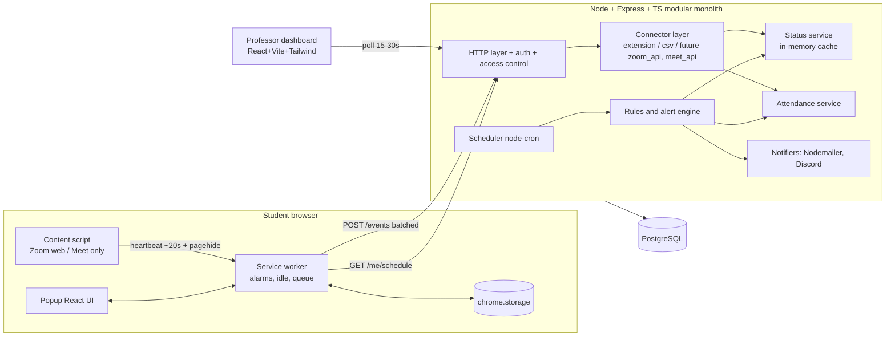

# NotifEye – Implementation Plan

Status: **APPROVED WITH CHANGES.** Phase 1 is partly done (database layer). This file is the source of truth for the project. Read it together with `docs/NotifEye_Design.md` (the full spec) at the start of every session.

Scope reminder: platforms are **Zoom and Google Meet only**. MS Teams is out of scope (no code, URL patterns, or events).

## Progress

| Phase | Status |
|---|---|
| 1 | **Complete, awaiting owner approval.** Database: Docker Compose (Postgres 16 + Mailpit, both published on `127.0.0.1` only), migration `1761317000000_initial-schema`, 11 app tables, `notifeye` and `notifeye_test` databases, `npm run db:check` passes (re-verified after the loopback rebind). Monorepo: npm workspaces `/extension`, `/dashboard` (placeholder), `/backend` (health-check shell only), `/shared`, `/docs`. `.env.example` and `.gitignore` (excludes `.env`) done. Empty MV3 extension (Vite + TS + React popup) builds and loads in Chromium with only `idle`, `alarms`, `storage`, `notifications`; the localhost host permission is added only by `--allow-localhost` (`npm run build`), and `npm run build:prod` is HTTPS-only. Screenshots in `docs/screenshots/`. Dev API binds to `127.0.0.1` outside production. **Open for owner decision:** schema naming deviations from section 4 (`enrollments.created_at` vs `joined_at`, `attendance_audit.created_at` vs `at`, event dedupe index also includes `class_id`). |
| 2-8 | Not started. Do not start Phase 2 until Phase 1 is complete and approved. |

Dev note: PowerShell blocks `npm.ps1` on this machine, so use `npm.cmd` (or `Set-ExecutionPolicy -Scope CurrentUser RemoteSigned`).

## 1. Decisions (all open questions are resolved)

| # | Topic | Decision |
|---|-------|----------|
| Q1 | Design doc | Exists at `docs/NotifEye_Design.md`. Use its fields and rules. |
| Q2 | Google sign-in | Extension: **email/password only**. Google sign-in only on the dashboard (professors). **No** `externally_connectable` handoff. |
| Q3 | HTTPS vs local dev | Dev/demo builds add `http://localhost:4000` via a build flag. The production build contains HTTPS hosts only. |
| Q4 | Dev email | Mailpit in Docker Compose. Gmail SMTP or SendGrid via env vars for real use. |
| Q5 | Real Zoom/Meet testing | Automated tests and the demo use local mock pages. The owner does one manual smoke test on real Zoom web and Meet. |
| - | Additions | `/shared` package, `attendance_audit` table, and the extra endpoints in section 6 are approved. |

### Required changes (approved)
1. **No false "left" events.** Never treat a content-script port disconnect as "meeting left" (the MV3 service worker can sleep and drop the port). Use a ~20 s heartbeat plus a final message on `pagehide`. Treat as left only if no reconnect or heartbeat arrives within a short grace window. Add a test that a service-worker restart does not produce a false `meeting_left`.
2. **Absent timing.** Show Absent once the grace period ends (the alert fires then). Flip to Late if the student joins afterward (audited).
3. `POST /events` rejects users without recorded consent.
4. Rate-limit `POST /classes/join` as well as the auth routes.
5. Dashboard JWT is stored in an **httpOnly cookie**.
6. `discord_webhook_url` is returned only to the owning professor and is never logged.

## 2. Architecture



### Tech choices
- **Monorepo**: npm workspaces: `/extension`, `/dashboard`, `/backend`, `/docs`, plus a small `/shared` package. It holds the event types, zod schemas, and status/attendance pure functions, so the extension, backend, and tests share one definition. Your spec lists four folders. `shared` is an addition, so tell me if you'd rather keep it inside `/backend`.
- **Backend**: Express + TypeScript, `pg` (no ORM), `node-pg-migrate` for SQL migrations, `zod` validation, `jsonwebtoken`, `bcrypt`, `google-auth-library`, `nodemailer`, `node-cron`, `helmet`, `express-rate-limit`.
- **Extension**: MV3 + TypeScript + Vite (multi-entry build: service worker, content script, popup). Popup in React.
- **Dashboard**: React + Vite + Tailwind, `react-router`, `recharts` for charts.
- **Tests**: Vitest (unit), Supertest against a real Postgres test DB (integration), Playwright for the extension/dashboard flows and screenshots.
- **Docker Compose**: Postgres 16 and Mailpit. The backend and dashboard run locally with `npm run dev`.

### Backend module layout (`/backend/src`)
```
modules/auth/        login, google, jwt middleware
modules/classes/     classes, enrollments, join-by-code, sessions, schedule
modules/status/      live status cache + computation
modules/attendance/  calculation, overrides, conflicts, export
modules/rules/       alert rules, evaluation engine
modules/alerts/      alert storage and delivery (email, discord, dashboard)
modules/scheduler/   cron jobs (1-min tick, session-end, retention)
modules/connectors/  normalize.ts, extension.ts, csv.ts, (zoom_api / meet_api stubs: types only)
modules/privacy/     consent, /me/data export, retention
shared/              db, config, errors, access-control helpers
```

## 3. Normalized event format (Connector Layer)
```ts
type NormalizedEvent = {
  user_id: string; class_id: string; session_id: string | null;
  type: 'meeting_joined' | 'meeting_left' | 'presence';
  state: 'active' | 'idle' | 'locked' | null;   // presence only
  timestamp: string;                              // ISO, original device time
  source: 'extension' | 'zoom_api' | 'meet_api' | 'csv';
}
```
Every connector outputs this. Downstream services (status, attendance, rules) only see `NormalizedEvent`. Events are deduplicated by `(user_id, type, timestamp, source)`. The server clamps absurd client clocks (future timestamps are rejected or capped).

## 4. Database schema (PostgreSQL, all timestamps `timestamptz` UTC)

| Table | Key columns |
|-------|-------------|
| `users` | id, email (unique), password_hash (nullable for Google), google_sub, name, **consent_at**, consent_version, created_at |
| `classes` | id, name, section, platform (`zoom`\|`meet`), class_code (unique), owner_id, discord_webhook_url (owner-only, never logged), created_at |
| `enrollments` | id, user_id, class_id, **role** (`professor`\|`student`), status (`pending`\|`approved`\|`removed`), **consent_at** (class-join consent), joined_at; unique (user_id, class_id) |
| `class_sessions` | id, class_id, starts_at, ends_at, meeting_link, meeting_id (normalized), grace_minutes, summary_sent_at |
| `attendance_records` | id, session_id, user_id, joined_at, left_at, status (`present`\|`late`\|`absent`), source, **overridden_by**, overridden_at, conflict (jsonb nullable), unique (session_id, user_id) |
| `activity_events` | id, user_id, class_id, session_id, type, state, timestamp, source, received_at; index (class_id, timestamp), (user_id, timestamp) |
| `extension_installs` | id, user_id, install_id, browser, version, first_seen, last_seen |
| `alert_rules` | id, class_id, kind, enabled, threshold, channels (email/dashboard/discord) |
| `alerts` | id, class_id, session_id, user_id (subject), kind, message, channels_sent, created_at, read_at; unique key per (session, user, kind) to prevent duplicates |
| `import_aliases` | id, class_id, alias (name/email from CSV), user_id, created_by |
| `attendance_audit` | id, attendance_id, actor_id, old_status, new_status, reason, at. Not in your list. This is the "logged override" store, so I'm adding it and need your OK. |

## 5. Rules

### Status (computed from the latest events per user and class, plus the clock)
Precedence, highest first. The label always carries its **source**.
1. **Not in session**: outside any session window.
2. **In Class**: a meeting_joined with no later meeting_left on the matching platform, and a report in the last 3 min.
3. **Away**: latest presence is `locked`.
4. **Idle**: latest presence is `idle`, or no input past the threshold (default 5 min).
5. **Online**: active and reported within 3 min.
6. **Offline**: no report for more than 3 min. This also overrides a stale "In Class", because an open tab can't be trusted if the extension has gone silent.

Note: "In Class overrides the rest" only applies while reports are fresh. An open meeting tab doesn't prove attention, so the dashboard shows "In Class (meeting tab open)" next to the idle/active state.

### Attendance
- `first_join ≤ starts_at + grace` → **Present**.
- `first_join > starts_at + grace` and before `ends_at` → **Late**.
- No join by `starts_at + grace` → **Absent** (shown and alerted at the end of the grace period). The record is finalized at `ends_at`.
- A join arriving after the Absent mark (before `ends_at`) flips the record to **Late**, audited.
- Overrides are written to `attendance_audit`, set `overridden_by`, and are never auto-reverted by later events.
- Conflicting sources (e.g. extension says joined, CSV says absent): store `conflict` and show both. Nothing auto-resolves. The professor decides.

### Alert rules
Absent (email + dashboard + Discord), Late arrival, Idle during class (default 10 min), Repeated absence (default 3 sessions), Left early (optional), Class reminder to students (10 min before, delivered by the extension via `chrome.notifications`). Thresholds are per-class and configurable.

### Scheduler (node-cron)
- Every minute: evaluate rules for sessions in progress and refresh the cache.
- Once per session at `ends_at`: finalize attendance, run end-of-session rules, send the per-session summary email, set `summary_sent_at` (idempotent).
- Nightly: delete events older than 180 days. Attendance records and alerts keep their data, with event references nulled.

## 6. API matrix

| Endpoint | Auth / access control |
|----------|-----------------------|
| `POST /auth/login`, `POST /auth/google`, (+ `POST /auth/register`) | public, rate-limited |
| `POST /classes` | any user, becomes professor on that class |
| `POST /classes/join` | any user, becomes pending student. Requires consent. Rate-limited. Invalid code returns 404 with a generic message |
| `GET /me/schedule` | self, approved enrollments only |
| `POST /events` (batched) | self, approved student in that class, **consent recorded**, session window and class must match |
| `GET /classes/:id/status` | professor of that class |
| `POST /classes/:id/sessions` | professor of that class |
| `GET /sessions/:id/attendance` | professor of that class |
| `PATCH /attendance/:id` | professor of that class, audited |
| `POST /sessions/:id/attendance/import` | professor of that class, CSV, uses `import_aliases` |
| `GET /me/data` | self only |
| `GET /alerts` | professor, own classes only |

Additions I'll need (beyond your list, all standard): `POST /auth/register`, `GET /classes` (mine), `PATCH /classes/:id/enrollments/:eid` (approve/remove), `GET/PUT /classes/:id/rules`, `POST /me/consent`, and `GET /sessions/:id/attendance.csv`. Every query takes the role from `enrollments` for the specific class. There is never a global role check.

## 7. Extension design

- **Manifest permissions**: `idle`, `alarms`, `storage`, `notifications`. Host permissions: Zoom web client (`https://*.zoom.us/wc/*`), `https://meet.google.com/*`, and the NotifEye API origin. No `tabs`, no `<all_urls>`, no `history`.
- **URL patterns**: `extension/src/config/platforms.ts` is the single editable file. It holds the match patterns and the meeting-ID extractors for Zoom and Meet. The manifest is generated from it at build time.
- **Content script** (matches only those two domains): extracts the meeting ID from `location` (not the DOM) and sends a heartbeat message to the service worker about every 20 s and a final message on `pagehide`. Heartbeats mean the meeting page is open. The meeting counts as left only after a `pagehide` message, or when heartbeats stop for longer than a short grace window. A port disconnect alone is never treated as leaving, because the service worker can sleep. It reads no page content.
- **Service worker**:
  - On the first heartbeat, compares the meeting ID to the schedule's `meeting_id`. If it doesn't match, the event is **dropped in memory and nothing is stored or sent**. If it matches inside a session window, it emits `meeting_joined` / `meeting_left`.
  - `chrome.alarms` every ~1 min (30 s in demo mode, the Chrome minimum): read `chrome.idle.queryState`, append `presence`, flush the batch.
  - Outside any session window: emits nothing and the popup shows "Not in session".
  - Queue in `chrome.storage.local` with original timestamps. Flush with retry and backoff when online. The server dedupes.
  - Schedule refreshed via `GET /me/schedule` on startup and periodically. Reminder alarm scheduled 10 min before each session start.
- **Popup (React)**: login, class code entry, consent screen, current class, own status, attendance history, and a "Monitoring active" indicator.
- **Meeting-ID caveat**: Meet links have the form `abc-defg-hij`. Zoom web client URLs carry the numeric meeting ID (`/wc/<id>/join` or `/wc/join/<id>`). Passcode params are stripped before comparison and never stored.

## 8. Dashboard design
Routes: Login, Classes list/create, Class live table (polls every 20 s), Student detail, Session attendance report (+ CSV export, + override, + CSV import with alias mapping), Alerts, Alert settings, Charts (attendance rate per session, status distribution). Each status badge shows its source tooltip. Browser Notification API is used for the dashboard alerts. Design direction: dark theme, glassy cards, color-coded status chips.

## 9. Phases and verification gates

| Phase | Deliverable | Verification before I stop |
|-------|------------|----------------------------|
| 1 | Monorepo, Docker Compose (Postgres + Mailpit, bound to 127.0.0.1), migrations for all tables, `.env.example`, `.gitignore`, empty MV3 extension (database part DONE) | `docker compose up`, migrations run, tables verified via psql, extension built and loaded in Chrome (screenshot of `chrome://extensions` and popup) |
| 2 | Auth (password + Google), class create, join by code, dashboard shell, popup login/join | Supertest for login and invalid code; browser walkthrough with screenshots |
| 3 | Sessions, `/me/schedule`, idle reporting, `/events`, status cache, live table | Screenshots of the live table changing status; unit tests of the status transitions |
| 4 | Zoom and Meet detection, attendance calculation | Mock-page tests for join/leave on both platforms; mismatch and out-of-window send nothing; grace-boundary tests |
| 5 | Rules engine, email/Discord/browser notifications, CSV import, overrides | Email seen in Mailpit, Discord webhook mock receives a payload, override audited |
| 6 | Reports, charts, consent screens, student data view | Screenshots, `/me/data` export check |
| 7 | Full test suite, offline queue, edge cases, privacy review | All tests green. Written privacy review in `/docs/privacy-review.md`. Checks that the manifest has no extra permissions |
| 8 | README, setup guide, seed script (1 professor, 3 students, 1 class, 1 session), demo mode, demo script | Fresh-clone run-through |

## 10. Test plan (maps to your list)
- Invalid class code rejected → integration
- Online→Idle→Away→Offline transitions → unit (pure function, injected clock)
- Present/Late/Absent around grace (boundary ±1 s, Absent→Late flip) → unit
- Unrelated meeting sends nothing; nothing outside the session window → extension logic unit tests plus a Playwright check that no `/events` request fires
- Join/leave on Zoom and Meet → unit on URL extractors plus Playwright with mock pages
- Cross-class access denied → integration (professor A vs. class B, student vs. status endpoints)
- Offline queue keeps original timestamps → unit with a fake storage and fake fetch
- Override logging → integration (audit row written, `overridden_by` set)
- Service-worker restart or sleep does not produce a false `meeting_left` → extension unit test (heartbeat gap vs. pagehide)
- `POST /events` without consent is rejected; `POST /classes/join` is rate-limited → integration

## 11. Privacy and security checklist
Consent stored with a timestamp at sign-in and at class join. Only the idle state and join/leave events are collected. No page content, history, other tabs, camera, mic, keystrokes, or screenshots. Bcrypt hashing, JWT with expiry (dashboard JWT in an httpOnly cookie), secrets from env, `.env.example` provided, helmet, CORS allow-list, rate-limited auth, zod validation on every body, parameterized SQL only. Students can view and export their own data. 180-day retention job. HTTPS enforced in production config. Local dev is HTTP on localhost only.

## 12. Out of scope (will not build)
MS Teams (no code, URL patterns, or events), mobile, SMS, desktop apps, Firefox/Safari, Kafka/RabbitMQ, LMS integration, AI risk scoring, guardian portal. `zoom_api` / `meet_api` appear only as reserved values in the `source` type.

## 13. Risks
- Zoom's web-client DOM and URL patterns change. I mitigate this with the URL-only approach and the editable config.
- MV3 service workers sleep. State lives in `chrome.storage` and `chrome.alarms` is the only timer.
- Real-meeting verification needs your manual smoke test (Q5).
- The Google OAuth client ID has to come from you for real Google sign-in. I'll wire it through env vars and stub it in tests.
